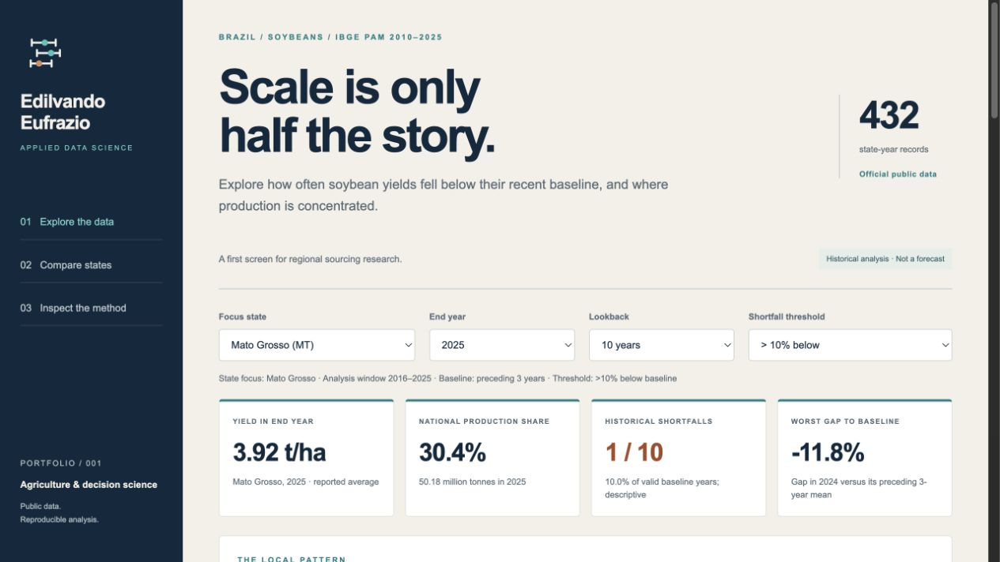

# Crop Yield Risk Explorer

**A decision-oriented view of Brazilian soybean production and historical yield shortfalls.**

By **[Edilvando Eufrazio](https://www.linkedin.com/in/edilvando-eufrazio-49b63417/)** · Applied Data Science

**[Open the live dashboard](https://edilvandopereira-dot.github.io/crop-yield-risk-explorer/)** · [Source repository](https://github.com/edilvandopereira-dot/crop-yield-risk-explorer)



This project asks a practical first-stage sourcing question: **where does production scale coexist with recurring or severe yield shortfalls?** It combines official IBGE public data, a transparent SQL baseline and an interactive offline dashboard. It helps identify regional histories to investigate further. It does not recommend suppliers, predict crop failures or estimate financial losses.

## Explore

Open [`docs/index.html`](docs/index.html) in a browser. It includes its chart library and data and works without a server or internet connection. Download the HTML file through GitHub's raw/download control rather than viewing its source page.

The dashboard supports:

- State, end-year and lookback selection.
- Shortfall thresholds of 5%, 10%, 15% and 20%.
- State comparisons by region and minimum harvested area.
- Yield trajectories, historical baselines and shortfall markers.
- Production share, frequency, severity and explicit observed denominators.
- Sortable comparisons and filtered JSON downloads.

The live dashboard is published with GitHub Pages from the `main` branch, `/docs` directory. The initial [analytical validation](https://github.com/edilvandopereira-dot/crop-yield-risk-explorer/actions/runs/38966130636) and [Pages deployment](https://github.com/edilvandopereira-dot/crop-yield-risk-explorer/actions/runs/38966284844) both completed successfully on 16 October 2026.

## First findings

Using the **2016–2025** evaluation window and a shortfall defined as yield **strictly more than 10% below the mean of the preceding three years**:

| State | Shortfall years | Worst gap to its baseline | Production in 2025 |
|---|---:|---:|---:|
| Mato Grosso | 1 / 10 | −11.8% | 50.18 million t |
| Rio Grande do Sul | 3 / 10 | −46.2% | 13.66 million t |
| Paraná | 2 / 10 | −30.5% | 21.29 million t |
| Goiás | 0 / 10 | −6.7% | 20.30 million t |

Mato Grosso accounted for approximately **30.4% of Brazil's reported soybean production in 2025**. These descriptive results illustrate why production volume and yield stability answer different questions. Zero observed events under one threshold does not establish that a state is safe or immune to future shocks. The threshold and period are analytical choices and should be tested through the controls.

## Data and provenance

- **Provider:** IBGE, Municipal Agricultural Production (PAM).
- **Table:** [SIDRA 1612](https://sidra.ibge.gov.br/tabela/1612).
- **Crop:** classification 81, category 2713, *Soja (em grão)*.
- **Coverage:** 2010–2025, 27 states and a separate national series. There are 432 state-year records and 16 national records.
- **Variables:** planted area (109), harvested area (216), production (214), reported yield (112).
- **Units:** hectares, tonnes and kg/ha. The dashboard displays yield in t/ha.
- **Retrieval:** see [`data/raw/manifest.json`](data/raw/manifest.json) for the exact timestamp, source queries and SHA-256 hashes.

The committed responses are the analytical snapshot. Refreshing the API may introduce revisions. Reproduce from the committed snapshot first, and treat a new download as a new data version.

SIDRA's `-` denotes an absolute zero. `...` is unavailable, `..` is not applicable and `X` is withheld. A yield for a location with no harvested area is undefined. It is excluded rather than imputed to zero. Raw symbols remain available alongside parsed fields. IBGE tabular conventions: [official methodological publication](https://biblioteca.ibge.gov.br/visualizacao/livros/liv23907.pdf).

## Method

For a state in year *t*:

```text
baseline_t = mean(yield_(t−3), yield_(t−2), yield_(t−1))
gap_t (%) = 100 × (yield_t / baseline_t − 1)
shortfall_t = gap_t < −threshold
historical frequency = observed shortfall years / valid baseline years
```

The baseline requires three valid consecutive earlier years. It never uses the current or a future year. All state-year rows, including undefined yield years, remain in the grid, so a SQL window cannot silently skip a missing year. The definition is implemented in [`sql/rolling_baseline.sql`](sql/rolling_baseline.sql).

Cross-state comparisons require at least five evaluable years within the selected window and a positive end-year harvested area. The minimum-area filter is a user choice, not an inferred market-entry recommendation. Mean yield in the comparison chart is the arithmetic mean of annual state yields within the window; it is not an area-weighted pooled yield. National shares use the official national production denominator, regardless of the comparison filters.

### Important limitations

- The source is an annual state aggregate, not farm-level longitudinal observations.
- Historical frequency is not a calibrated probability of next year's shortfall.
- The rolling reference can lag a yield trend, making threshold and lookback sensitivity important.
- Observed changes cannot be attributed to weather, management or policy with this dataset alone.
- This is a **current-vintage retrospective analysis**, not a backtest using the data that were available at each historical publication date.
- There is no claim of predictive skill, causal impact or business ROI. A more complex model should be added only with a specified predictive question and a leakage-aware evaluation.

## Reproduce

The pipeline, SQL engine and tests use **Python 3.10+ and the standard library only**. The optional social-figure export requires matplotlib.

```bash
python3 -m unittest discover -s tests -v
python3 scripts/build.py
```

To retrieve a new source version deliberately:

```bash
python3 scripts/fetch_data.py
python3 scripts/build.py
```

Before refreshing, preserve the old snapshot in Git. API changes or mismatches fail the build for review rather than silently producing a dashboard.

## Validation

The build checks source hashes, crop and variable identifiers, state-year uniqueness, a complete 27 × 16 grid, 48 additive state-to-national reconciliations, and consistency between reported yield and production/harvested area with a 2 kg/ha rounding tolerance. Results are recorded in [`data/qa.json`](data/qa.json).

Unit tests target analytical failures that change conclusions: future leakage in the baseline, missing-year handling, mixing state histories and source-symbol semantics. The dashboard also receives manual browser checks for state and threshold changes, comparison filters, downloads and mobile layout. The workflow in `.github/workflows/check.yml` runs the numerical checks once pushed to GitHub; remote CI status must be verified there.

## Repository map

```text
data/raw/          Original API responses and provenance manifest
data/processed/    Validated observations and derived features
sql/              Transparent rolling baseline
scripts/          Retrieval, validation and dashboard generation
tests/            Analytical semantics checks
web/              Editable dashboard HTML, CSS and JavaScript
docs/index.html   Self-contained dashboard, ready for GitHub Pages
brand/            Personal identity assets
assets/           Dashboard preview and social figure
communication/    LinkedIn draft and alt text
```

## Next releases

1. Test alternative historical references and show which descriptive conclusions change.
2. Evaluate co-movement of regional yield gaps before drawing a diversification conclusion.
3. Add municipality-level exploration with explicit coverage, administrative-boundary checks and disclosure limits.
4. Add climate covariates only after defining a prediction horizon, feature availability and temporal evaluation protocol.

These are planned extensions, not implemented capabilities.

## Attribution

Independent personal project by Edilvando Eufrazio. Developed with AI-assisted implementation and analytical review. Public IBGE data are attributed to their source. No institutional endorsement, nonpublic Embrapa research data or confidential employer information is included.

Original project code is under the [MIT license](LICENSE). IBGE data and third-party Chart.js code retain their respective attribution and terms. See `vendor/Chartjs-LICENSE.md` for Chart.js.
